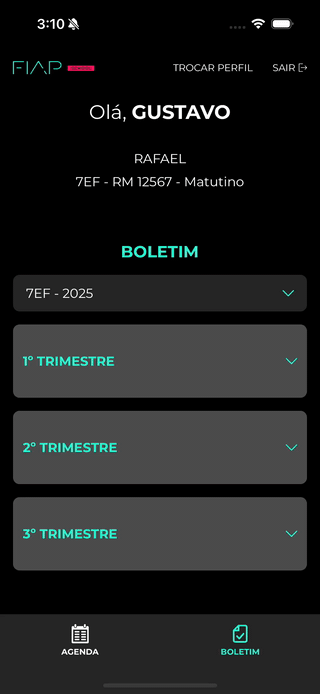
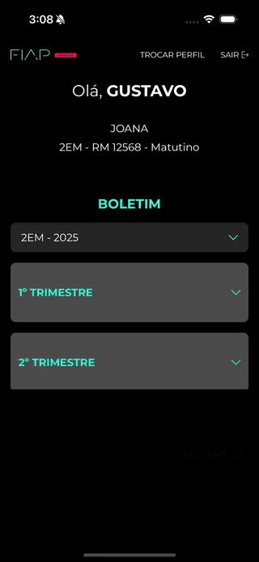
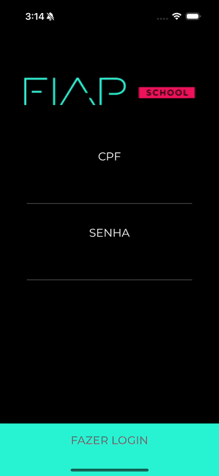
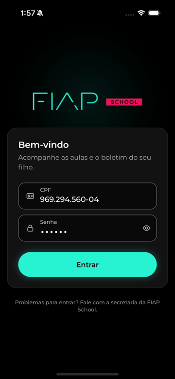
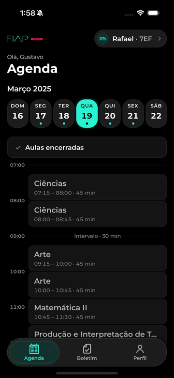
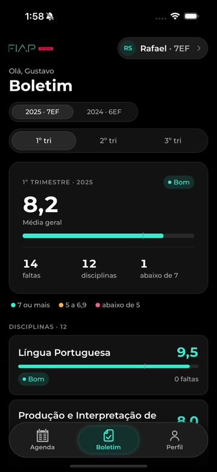
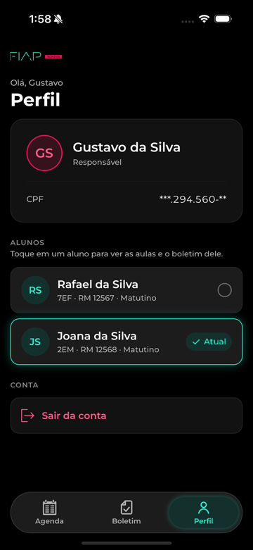
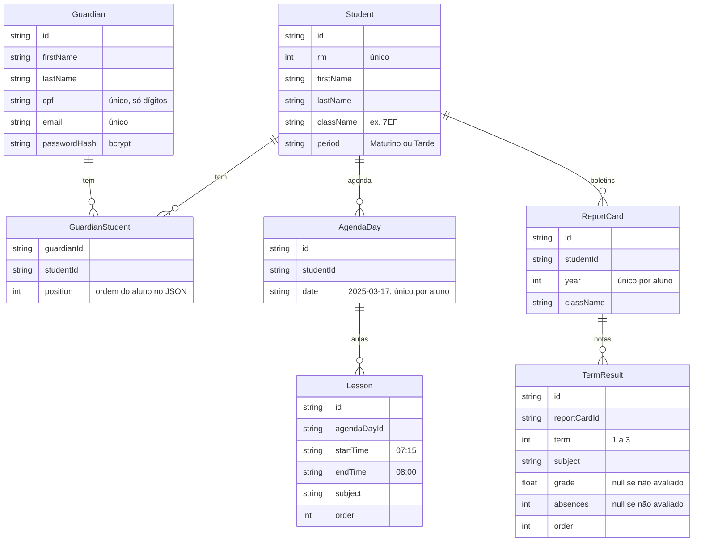

# FIAP School

Teste técnico de Mobile da FIAP School. É um app para os responsáveis
acompanharem as aulas do dia e o boletim anual (notas e faltas) dos alunos,
mais uma API própria em NestJS, que substitui o JSON do enunciado.

- Enunciado: [`docs/teste-tecnico-mobile.md`](docs/teste-tecnico-mobile.md)
  (transcrição do [.docx original](docs/teste-tecnico-mobile.docx))
- Design: [`docs/figma/README.md`](docs/figma/README.md) (tokens, componentes e
  telas extraídos do Figma)
- Spec do projeto: [`00-brief.md`](.claude/team/tarefas/2026-10-27-fiap-school/00-brief.md)

## Início rápido

### Pré-requisitos

| Para | O que instalar |
|---|---|
| Tudo | Node.js 24 (o `.nvmrc` da raiz) e yarn (`npm i -g yarn`; o `mobile/` já traz o yarn 4 dele) |
| Android | **JDK 17** e Android Studio com o SDK Platform 37, Build-Tools 37.0.0, NDK 27.1.12297006 e um emulador |
| iOS (só macOS) | Xcode 16+ e um Ruby 3 do Homebrew ou do rbenv (ver o aviso do iOS abaixo) |

JDK 17 (a versão que o CI usa para buildar o Android e rodar o Maestro):

```sh
# macOS (o JDK que o guia do React Native recomenda)
brew install --cask zulu@17
export JAVA_HOME=/Library/Java/JavaVirtualMachines/zulu-17.jdk/Contents/Home

# Linux (Debian/Ubuntu)
sudo apt install openjdk-17-jdk
export JAVA_HOME=/usr/lib/jvm/java-17-openjdk-amd64

java -version   # deve mostrar 17
```

SDK do Android (no Android Studio, em **SDK Manager**) e as variáveis no
`~/.zshrc` ou `~/.bashrc`, junto com o `JAVA_HOME`:

```sh
export ANDROID_HOME=$HOME/Library/Android/sdk   # Linux: $HOME/Android/Sdk
export PATH=$PATH:$ANDROID_HOME/emulator:$ANDROID_HOME/platform-tools
```

Detalhes em [Pré-requisitos](#pré-requisitos).

### 1. API (vale para as duas plataformas)

```sh
# Terminal 1, na raiz do repositório: API em http://localhost:3333 (Swagger em /docs)
cd api
cp .env.example .env
yarn install
yarn prisma:setup
yarn start:dev
```

### 2. Metro (bundler do JavaScript)

Deixe o Metro rodando num terminal próprio, antes de abrir o app. O `yarn
android` e o `yarn ios` tentam abri-lo sozinhos numa janela nova, mas isso nem
sempre funciona (no Linux depende do emulador de terminal), e num terminal seu
você vê os logs e o erro de bundle.

```sh
# Terminal 2, na raiz do repositório
cd mobile
yarn install
cp .env.example .env   # o API_URL padrão já serve no emulador Android e no simulador iOS
yarn start             # Metro na porta 8081; yarn start --reset-cache limpa o cache
```

### 3a. App no Android (emulador)

Abra um emulador pelo Android Studio (**Device Manager**) e confira que ele
aparece em `adb devices`. Depois:

```sh
# Terminal 3, na raiz do repositório
cd mobile
yarn android
```

O `API_URL` padrão (`localhost`) funciona porque, no Android, o app troca
`localhost` por `10.0.2.2`, que é a máquina vista de dentro do emulador. Num
aparelho físico, use o IP da máquina (ver [Android](#android)).

### 3b. App no iOS (simulador, só macOS)

```sh
# Terminal 3, na raiz do repositório
cd mobile
cd ios && bundle install && bundle exec pod install && cd ..
yarn ios
```

> **Ruby do sistema no macOS:** com ele, o `bundle install` (e o `yarn ios`,
> que o roda sozinho) falha na gem `json`. Antes, ative um Ruby 3
> (`brew install ruby`) ou use o CocoaPods do Homebrew com o build pelo Xcode:
> os dois caminhos estão em [iOS](#ios-macos).

### 4. Entrar no app

> [!IMPORTANT]
> **Usuário para entrar no app**
>
> | CPF | Senha |
> |---|---|
> | **`969.294.560-04`** | **`123456`** |
>
> É o Gustavo, responsável por dois alunos (Rafael e Joana), a conta que mostra
> todas as telas, inclusive a troca de aluno. As outras contas estão em
> [Credenciais de teste](#credenciais-de-teste).

Para rodar os testes de tela, veja [Flows do Maestro](#flows-do-maestro).

## Sumário

- [Início rápido](#início-rápido)
- [Visão geral](#visão-geral)
- [Demonstração](#demonstração)
- [v2 (UI moderna)](#v2-ui-moderna)
- [Stack e dependências](#stack-e-dependências)
- [Pré-requisitos](#pré-requisitos)
- [Como rodar a API](#como-rodar-a-api)
- [Como rodar o app](#como-rodar-o-app)
- [Credenciais de teste](#credenciais-de-teste)
- [Testes e qualidade](#testes-e-qualidade)
  - [Flows do Maestro](#flows-do-maestro)
- [Arquitetura](#arquitetura)
- [Como o projeto foi construído com IA (SDD)](#como-o-projeto-foi-construído-com-ia-sdd)
- [Decisões e limitações conhecidas](#decisões-e-limitações-conhecidas)
- [Próximos passos](#próximos-passos)
- [Troubleshooting](#troubleshooting)

## Visão geral

O repositório tem duas partes independentes, cada uma com seu `package.json` e
seu `yarn.lock` (sem workspaces):

| Pasta | O que é |
|---|---|
| `api/` | API REST em NestJS + Prisma + SQLite, com login por CPF e JWT |
| `mobile/` | App em React Native CLI + TypeScript + Restyle |
| raiz | tooling comum (husky, commitlint, lint-staged), workflows do GitHub Actions, docs e a configuração da IA (`.claude/`) |

### Telas do app

| Tela | O que faz |
|---|---|
| Splash animada | Splash nativa (react-native-bootsplash) seguida de uma animação em JS enquanto o app valida a sessão salva |
| Login | CPF com máscara `XXX.XXX.XXX-XX` e senha. Credencial errada mostra a mensagem da API, com animação |
| Agenda (Aulas) | Aulas de um dia (início, término e disciplina), com um dropdown para os 7 dias da semana. Dia sem aula mostra a ilustração e "Sem aulas neste dia" |
| Boletim | Abre em 2025, com os trimestres em acordeão e nota e faltas por disciplina. Trimestre não avaliado mostra `-`. O dropdown de turma e ano leva aos anos anteriores |
| Seleção de aluno | Modal de tela cheia, fora do rodapé, que só aparece para quem tem mais de um aluno. Escolher um aluno volta para a tela de origem |
| Sem aluno | Responsável sem aluno vinculado vê um estado vazio com o botão de sair |
| Erro | API fora do ar ou erro de servidor mostra o estado de erro com "Tentar de novo" (na abertura do app e em cada tela) |

Em toda tela autenticada o cabeçalho mostra o primeiro nome do responsável, o
primeiro nome, RM, turma e período do aluno, o botão `TROCAR PERFIL` (só com
mais de um aluno) e o botão `SAIR`. O rodapé navega entre Aulas e Boletim.

### API própria no lugar do JSON

O enunciado entrega um JSON com os responsáveis, alunos, agenda e boletim. Aqui
ele virou a carga inicial do banco: o JSON oficial está em
[`docs/data/responsaveis.json`](docs/data/responsaveis.json), uma cópia dele em
`api/prisma/seed-data/` alimenta o seed, e o app consome a API com autenticação.
O seed separa `horario` em início e fim, guarda a senha com bcrypt e acrescenta
um responsável sem aluno (Carlos), para o cenário de erro.

Rotas (prefixo `/api`):

| Método | Rota | Retorno | Auth |
|---|---|---|---|
| POST | `/api/auth/login` | `{ accessToken, guardian }` a partir de `{ cpf, password }` | pública |
| GET | `/api/me` | responsável (CPF mascarado) e alunos vinculados | JWT |
| GET | `/api/students/:id/agenda` | os 7 dias da agenda, com as aulas de cada dia | JWT + aluno do responsável |
| GET | `/api/students/:id/report-cards` | anos com boletim, do mais recente ao mais antigo | JWT + aluno do responsável |
| GET | `/api/students/:id/report-cards/:year` | boletim do ano, por trimestre e disciplina | JWT + aluno do responsável |
| GET | `/api/health` | estado da API | pública |

A documentação interativa (Swagger) fica em `http://localhost:3333/docs`, com o
botão **Authorize** para colar o token do login.

## Demonstração

Gravado no simulador iOS (iPhone 16) com a API local, durante o QA. Os vídeos
originais estão em
[`evidencias/qa/`](.claude/team/tarefas/2026-10-27-fiap-school/evidencias/qa/).

| Login | Agenda | Boletim |
|---|---|---|
|  |  |  |
| Splash animada, CPF com máscara, senha errada e login | Dropdown dos dias, aulas e dia sem aula | Trimestres em acordeão, `-` no não avaliado e ano anterior |

| Troca de aluno | Sem aluno e erro |
|---|---|
|  |  |
| TROCAR PERFIL a partir do Boletim e da Agenda | Responsável sem aluno; boletim com a API parada e "Tentar de novo" |

## v2 (UI moderna)

A branch `release/v2` traz uma evolução da interface sobre a mesma API: tab
bar flutuante com a aba **Perfil** (dados do responsável, troca de aluno e
sair), header compacto com o chip do aluno, **Login** novo, **Agenda** em
timetable (faixa semanal, pager de dias e linha de "agora") e **Boletim** por
faixas de nota (resumo do trimestre, barras e legenda), com pull-to-refresh
nas três abas.

**A entrega oficial do teste continua sendo a v1** (branch `master`), fiel ao
Figma. A v2 foi feita por decisão de prazo **sem testes novos**, sem QA e sem
revisão de segurança dedicados: os testes da v1 foram só ajustados, e a
suíte, o lint, o `tsc` e a checagem dos flows do Maestro seguem verdes.

| Login | Agenda | Boletim | Perfil |
|---|---|---|---|
|  |  |  |  |

## Stack e dependências

### App (`mobile/`)

O app é **React Native CLI** (projeto bare, com as pastas `ios/` e `android/`
versionadas), sem Expo: o nativo segue o template do React Native 0.88, e só
entram as dependências que o app usa.

| Dependência | Versão | Para quê |
|---|---|---|
| `react-native` | 0.88.0 | Base do app (React 19.3, nova arquitetura) |
| `@shopify/restyle` | 2.4 | Tema tipado com os tokens do Figma (cores, espaçamentos, tipografia, variantes) |
| `@react-navigation/native`, `native-stack`, `bottom-tabs` | 7.x | Stack (login, app, seleção de aluno em modal) e abas Aulas/Boletim com tab bar própria |
| `@tanstack/react-query` | 5.104 | Todo dado remoto (`/me`, agenda, boletim), com cache por aluno e retry |
| `zustand` | 5.0 | Estado global: sessão e aluno selecionado |
| `react-native-mmkv` (+ `react-native-nitro-modules`) | 4.3 | Persistência do aluno selecionado |
| `react-native-keychain` | 10.0 | JWT no Keychain (iOS) e no Keystore (Android), nunca no AsyncStorage |
| `zod` | 4.6 | Validação do formulário de login e das respostas da API (os tipos saem dos schemas) |
| `react-hook-form` + `@hookform/resolvers` | 7.90 / 5.9 | Formulário de login com `zodResolver` |
| `axios` | 1.20 | HTTP com interceptors de token, de 401 (limpa a sessão) e de log |
| `react-native-config` | 1.7 | `API_URL` lida do `.env` no build |
| `react-native-reanimated` + `react-native-worklets` | 4.7 / 0.13 | Animações de entrada, dropdown, acordeão, splash |
| `react-native-screens`, `react-native-safe-area-context` | 4.30 / 5.10 | Dependências nativas da navegação e das áreas seguras |
| `react-native-bootsplash` | 7.3 | Splash nativa, escondida quando a animação em JS assume |
| `react-native-svg` | 15.16 | Ícones e ilustrações |
| `reactotron-react-native` | 5.3 | Inspeção em dev de logs, requests e estado (sem token nem senha) |

Testes e qualidade: `jest` 29 com `@react-native/jest-preset`,
`@testing-library/react-native` 14 (componentes e ViewModels), `msw` 2.15 (mock
da API nos testes), ESLint (`@react-native/eslint-config`), Prettier e
TypeScript 6 (`tsc --noEmit`). Fonte Montserrat embutida (`assets/fonts`, licença
OFL em `assets/licenses`).

Outras dependências de desenvolvimento: `@babel/plugin-transform-export-namespace-from`
(o preset do React Native não transforma o `export * as` do zod 4, e sem ele o
bundle de release quebra), `yaml` 2.9 (lido pelo `yarn maestro:check`) e
`react-native-asset` (liga as fontes ao nativo, `yarn link:assets`).

### API (`api/`)

| Dependência | Versão | Para quê |
|---|---|---|
| `@nestjs/core`, `common`, `platform-express` | 11 | Framework HTTP |
| `@nestjs/config` | 4.0 | Leitura e validação das envs no boot (class-validator) |
| `prisma` + `@prisma/client` + `@prisma/adapter-better-sqlite3` | 7.10.1 | ORM, migrations e seed sobre SQLite |
| `@nestjs/jwt` + `@nestjs/passport` + `passport-jwt` | 11 / 4.0 | Emissão e validação do JWT (HS256) |
| `bcryptjs` | 3.0 | Hash das senhas (JS puro, sem build nativo) |
| `class-validator` + `class-transformer` | 0.15 / 0.5 | DTOs validados pelo `ValidationPipe` global e o validador `@IsCpf()` |
| `@nestjs/throttler` | 6.7 | Rate limit do login por IP (o limite por CPF é próprio) |
| `@nestjs/swagger` | 11.4 | OpenAPI em `/docs` |
| `nestjs-pino` + `pino` + `pino-http` | 5.3 / 10 / 11 | Log estruturado com request-id e `redact` de token, senha e CPF |
| `helmet` | 8.3 | Cabeçalhos de segurança HTTP |
| `tsx` + `dotenv` | | Rodar o seed em TypeScript e ler o `.env` no Prisma |

Testes e qualidade: `jest` 30 + `ts-jest` (unitários e e2e), `supertest` (e2e
contra um SQLite de teste), `@nestjs/testing`, ESLint 9 + Prettier, TypeScript
5.9, `pino-pretty` (log legível em dev).

### Raiz

`husky` 9 (hooks do git), `@commitlint/cli` + `config-conventional` 21
(mensagens de commit) e `lint-staged` 17 (lint só dos arquivos staged).

## Pré-requisitos

| Ferramenta | Versão | Usada em |
|---|---|---|
| Node.js | 24 (o `.nvmrc` da raiz) | tudo |
| yarn | 1.22 na raiz e em `api/`; 4.18.1 em `mobile/` | ver abaixo |
| Xcode + CocoaPods | Xcode 16 ou mais novo, CocoaPods 1.13+ | iOS (só macOS) |
| Ruby 3 (Homebrew, rbenv ou asdf) | 3.x, para o `bundle install` | iOS pelo `Gemfile` (ou CocoaPods do Homebrew, ver [iOS](#ios-macos)) |
| JDK 17 + Android Studio | SDK Platform 37, Build-Tools 37.0.0, NDK 27.1.12297006 e um emulador | Android (ver abaixo) |
| Docker | opcional | subir a API com um comando |
| Maestro + Java 17 | opcional, 2.11.0 (a do CI) | flows de tela (ver [Flows do Maestro](#flows-do-maestro)) |

Sobre o yarn: a raiz e a `api/` usam yarn 1 (`packageManager: yarn@1.22.22`). O
`mobile/` usa yarn 4.18.1, que já vem versionado em `mobile/.yarn/releases/` e é
escolhido pelo `.yarnrc.yml` da pasta. Com o yarn 1 global instalado, rodar
`yarn` dentro de `mobile/` já usa o yarn 4. O `corepack enable` também funciona
(é o que o CI usa).

Ambiente do React Native: siga o
[guia oficial](https://reactnative.dev/docs/set-up-your-environment) para Xcode
e Android Studio. O watchman não é necessário (o Metro está configurado sem
ele).

Para o Android, o projeto compila com `compileSdkVersion` 37,
`buildToolsVersion` 37.0.0, `ndkVersion` 27.1.12297006 e `minSdkVersion` 24
(`mobile/android/build.gradle`). No Android Studio, em **SDK Manager**, instale
o *Android SDK Platform 37*, o *Build-Tools 37.0.0* e o *NDK (Side by side)*
27.1.12297006 (reanimated, worklets e mmkv têm código C++). Configure as
variáveis no shell:

```sh
export JAVA_HOME=<caminho do JDK 17>
export ANDROID_HOME=$HOME/Library/Android/sdk   # Linux: $HOME/Android/Sdk
export PATH=$PATH:$ANDROID_HOME/emulator:$ANDROID_HOME/platform-tools
```

Na raiz, instale as dependências uma vez para ativar os hooks do git:

```sh
yarn install
```

## Como rodar a API

Os dois caminhos sobem a API em `http://localhost:3333`. A Opção A é a
verificada durante o desenvolvimento; a Opção B ainda não foi executada (ver o
aviso nela).

### Opção A: local, com yarn

```sh
cd api
cp .env.example .env
yarn install          # também roda prisma generate
yarn prisma:setup     # aplica as migrations e roda o seed (cria api/dev.db)
yarn start:dev        # sobe em modo watch na porta 3333
```

Para rodar local, o `JWT_SECRET` do `.env.example` serve. Ele é público, e com
`NODE_ENV=production` a API se recusa a subir com ele. Para trocar, gere um
valor com `openssl rand -base64 48` e cole entre aspas na linha `JWT_SECRET=`
do `api/.env`.

Confira:

- Health: `http://localhost:3333/api/health`
- Swagger: `http://localhost:3333/docs`

Teste rápido pelo terminal:

```sh
curl -s -X POST http://localhost:3333/api/auth/login \
  -H 'Content-Type: application/json' \
  -d '{"cpf":"969.294.560-04","password":"123456"}'
```

Para rodar o build compilado: `yarn build && yarn start:prod`.

### Opção B: Docker

> **Ainda não executado.** O `Dockerfile`, o `docker-compose.yml` e o teste do
> container estão prontos, mas a máquina de desenvolvimento não tem Docker. A
> primeira execução real é o job `docker` do `api.yml`, no primeiro CI do
> repositório. Se o build falhar, use a Opção A.

Na raiz do repositório:

```sh
docker compose up --build
```

O container roda `migrate deploy` e o seed a cada boot e sobe a API com o
Swagger ligado. O banco SQLite fica no volume `api-data`.

- **Segredo do JWT:** sem `JWT_SECRET` na env, o container gera um segredo
  aleatório na primeira subida, grava no volume (`/app/data/jwt-secret`) e
  reaproveita nos próximos boots, para os tokens continuarem valendo depois de
  um restart. Para usar o seu:
  `JWT_SECRET="$(openssl rand -base64 48)" docker compose up --build`.
- **Limites de login:** sobrescreva na linha de comando, por exemplo
  `LOGIN_THROTTLE_LIMIT=1000 LOGIN_THROTTLE_CPF_LIMIT=1000 docker compose up`
  (útil para os testes de tela, que fazem muitos logins).
- **Porta:** o compose publica a 3333 em todas as interfaces, para um celular na
  mesma rede chegar pelo IP da máquina. Para expor só nesta máquina, troque para
  `"127.0.0.1:3333:3333"` no `docker-compose.yml`.
- **Apagar tudo:** `docker compose down -v` remove o volume (banco e segredo).

### Variáveis de ambiente da API

Valores do [`api/.env.example`](api/.env.example). A API valida todas no boot e
não sobe com valor inválido.

| Variável | Padrão do exemplo | O que faz |
|---|---|---|
| `DATABASE_URL` | `file:./dev.db` | Caminho do SQLite, relativo a `api/` |
| `PORT` | `3333` | Porta HTTP |
| `JWT_SECRET` | valor de exemplo | Segredo HS256, com 32 caracteres ou mais. Gere com `openssl rand -base64 48`. O valor do exemplo é recusado com `NODE_ENV=production` |
| `JWT_EXPIRES_IN` | `7d` | Validade do token, com unidade obrigatória (`s`, `m`, `h`, `d`, `w`, `y`) |
| `CORS_ORIGINS` | `*` | Origens separadas por vírgula, ou `*`. Sem a variável, vale `*` fora de produção; com `NODE_ENV=production` a variável é obrigatória (o compose define `*` de propósito) |
| `LOGIN_THROTTLE_LIMIT` | `5` | Tentativas de login por IP dentro da janela |
| `LOGIN_THROTTLE_TTL_MS` | `60000` | Janela do limite por IP (ms) |
| `LOGIN_THROTTLE_CPF_LIMIT` | `10` | Falhas de login por CPF (de qualquer IP). Login certo não conta e zera as falhas |
| `LOGIN_THROTTLE_CPF_TTL_MS` | `900000` | Janela do limite por CPF (ms), contada da primeira falha |
| `NODE_ENV` | `development` | `development` deixa o log legível (pino-pretty); qualquer outro valor sai em JSON |
| `LOG_LEVEL` | `info` | `fatal`, `error`, `warn`, `info`, `debug`, `trace` ou `silent` |
| `SWAGGER_ENABLED` | `true` | Liga o Swagger em `/docs`. Sem a variável, fica ligado fora de produção |
| `TRUST_PROXY` | `false` | `trust proxy` do Express, que decide o IP do rate limit: `false`, número de saltos ou lista de IPs. `true` é recusado |
| `SEED_RESET` | `false` | Com `true`, o seed apaga e recria os dados do JSON. Com `false`, só popula um banco vazio |

### Resetar o banco

| Situação | Comando |
|---|---|
| Local: recriar o banco do zero (migrations + seed) | `cd api && yarn prisma:reset` |
| Local: só recarregar os dados do JSON | `cd api && SEED_RESET=true yarn prisma:seed` |
| Docker: recriar os dados a cada boot | `SEED_RESET=true` no `environment` do `docker-compose.yml` |
| Docker: apagar banco e segredo | `docker compose down -v` |

`yarn prisma:reset` apaga o `api/dev.db` inteiro. Os tokens emitidos antes
deixam de valer, porque os ids dos responsáveis mudam.

## Como rodar o app

Com a API rodando (seção anterior):

```sh
cd mobile
corepack enable        # opcional: o yarn 4.18.1 já vem em .yarn/releases
yarn install
cp .env.example .env   # e ajuste o API_URL, ver a tabela abaixo
```

O `API_URL` aponta para a API, com o sufixo `/api`:

| Onde o app roda | `API_URL` |
|---|---|
| Simulador iOS | `http://localhost:3333/api` (o padrão do exemplo) |
| Emulador Android | `http://10.0.2.2:3333/api` (o app também troca `localhost` por `10.0.2.2` sozinho no Android) |
| Aparelho físico (iPhone ou Android) | `http://<IP da máquina na rede>:3333/api`, com o celular na mesma rede Wi-Fi |

Sem `API_URL`, o app usa `localhost` no iOS e `10.0.2.2` no Android. O
`react-native-config` grava o `.env` no binário: depois de mudar o `.env`, rode
o build de novo (`yarn ios` ou `yarn android`), não basta recarregar o
Metro.

### iOS (macOS)

O `mobile/Gemfile` (do template do React Native) instala o CocoaPods pelo
bundler, e o `yarn ios` roda `bundle install` + `bundle exec pod install`
sozinho na primeira vez. Isso pede um Ruby que compile extensões nativas: com o
Ruby 2.6 do sistema do macOS, o `bundle install` falha na gem `json` e o
`yarn ios` para em "Something went wrong while installing CocoaPods". Há dois
caminhos, os dois testados num clone limpo:

**Caminho A: Ruby 3 + bundler** (o `yarn ios` funciona do começo ao fim)

```sh
brew install ruby                              # ou um Ruby 3 do rbenv/asdf
export PATH="$(brew --prefix ruby)/bin:$PATH"  # neste terminal
cd ios
bundle install            # instala o CocoaPods do Gemfile em mobile/vendor/bundle
bundle exec pod install
cd ..
yarn ios                  # ou: yarn ios --simulator "iPhone 16"
```

O CocoaPods do Gemfile é o 1.15.2, então o `pod install` troca a última linha
do `ios/Podfile.lock` (`COCOAPODS: 1.16.2` → `1.15.2`). Isso não muda o build;
se não quiser a diferença no `git status`, `git checkout -- ios/Podfile.lock`.
O `mobile/Gemfile.lock` que o bundler cria é ignorado pelo git.

**Caminho B: CocoaPods do Homebrew, sem bundler e sem `yarn ios`**

```sh
brew install cocoapods
cd ios && pod install && cd ..
yarn start                # Metro na 8081, deixe este terminal aberto
```

Em outro terminal, também em `mobile/`, builde pelo Xcode
(`open ios/FiapSchool.xcworkspace`, escolha um simulador e clique em Run) ou
pela linha de comando:

```sh
cd ios
xcrun simctl list devices available   # copie o id (UDID) de um iPhone
UDID=<id do simulador>
xcrun simctl boot "$UDID" 2>/dev/null; open -a Simulator
xcodebuild -workspace FiapSchool.xcworkspace -scheme FiapSchool \
  -configuration Debug -sdk iphonesimulator \
  -destination "platform=iOS Simulator,id=$UDID" \
  -derivedDataPath build/cli build
xcrun simctl install "$UDID" build/cli/Build/Products/Debug-iphonesimulator/FiapSchool.app
xcrun simctl launch "$UDID" br.com.fiap.school
```

Use o id, não o nome: com `name=iPhone 16`, o `xcodebuild` procura o aparelho
no runtime de iOS mais novo instalado e falha se ele só existir num runtime
mais antigo ("Unable to find a device matching the provided destination").
Não use `yarn ios` neste caminho: ele tenta o `bundle install` de novo e falha.

**Metro em outra porta.** Se a 8081 estiver ocupada por outro projeto, suba o
Metro com `yarn start --port 8090` e aponte o app instalado para ela:
`xcrun simctl spawn booted defaults write br.com.fiap.school RCT_jsLocation localhost:8090`
(e reabra o app). O `yarn ios --port` sozinho não basta: o app continua
procurando a 8081. Para voltar ao padrão,
`xcrun simctl spawn booted defaults delete br.com.fiap.school RCT_jsLocation`.

iPhone físico: abra `ios/FiapSchool.xcworkspace` no Xcode, escolha o seu Team
em *Signing & Capabilities* do target `FiapSchool` (uma conta Apple gratuita
basta para instalar no próprio aparelho) e rode `yarn ios --device`.

### Android

Abra um emulador pelo Android Studio (Device Manager) ou conecte um aparelho com
depuração USB, e então:

```sh
yarn android
```

Num aparelho Android, use o IP da máquina no `API_URL` (tabela acima). Não use
`localhost`: no Android o app troca `localhost` e `127.0.0.1` por `10.0.2.2`,
que só existe no emulador.

### Metro

`yarn ios` e `yarn android` abrem o Metro sozinhos. Para subir à parte, use
`yarn start` (porta 8081; `yarn start --reset-cache` limpa o cache). O Metro está
configurado com `useWatchman: false` (`mobile/metro.config.js`), então funciona
mesmo sem watchman ou com o watchman quebrado.

## Credenciais de teste

Todas vêm do seed (`yarn prisma:setup` ou `docker compose up`):

| Responsável | CPF | Senha | Alunos |
|---|---|---|---|
| Gustavo | `969.294.560-04` | `123456` | 2: Rafael (7EF, boletins de 2025 e 2024) e Joana (2EM) |
| Adelaide | `508.795.670-07` | `987654` | 1: Bianca (1EF) |
| Carlos | `314.159.265-90` | `111111` | nenhum (extra nosso, não está no JSON do enunciado) |

- O CPF pode ser digitado com ou sem máscara. CPF inexistente e senha errada dão
  a mesma mensagem.
- Com Gustavo aparece o botão `TROCAR PERFIL`. Com Adelaide não. Carlos cai na
  tela de responsável sem aluno.
- A agenda do JSON é uma semana fixa, de 16 a 22/03/2025 (domingo a sábado). O
  app abre no dia dessa semana que tem o **mesmo dia da semana de hoje**: numa
  terça, abre em 18/03/2025. Sábado e domingo mostram "Sem aulas neste dia".
- O boletim abre em 2025, com só o 1º trimestre avaliado (2º e 3º mostram `-`).
- Login devolvendo 429: ver [Troubleshooting](#troubleshooting).

## Testes e qualidade

### API (`cd api`)

| Comando | O que roda |
|---|---|
| `yarn test` | Unitários (Jest): cada use case tem seu `.spec.ts`, mais guards, decorators, pipes, logger, throttling, config e seed |
| `yarn test:cov` | Unitários com cobertura (`api/coverage/`) |
| `yarn test:e2e` | e2e com supertest sobre um SQLite próprio (`test.db`, com migrate + seed antes da suíte): login, `/me`, agenda, boletim, 401, 403 de ownership em todas as rotas por aluno, rate limit, Swagger, headers de segurança e logs sem dado sensível |
| `yarn build && ./scripts/smoke.sh` | Smoke no build: sobe o `dist/` com banco novo e confere login, `/me`, boletim, Swagger, `x-request-id` e o log (precisa de `curl` e `jq`) |
| `yarn lint` / `yarn tsc` | ESLint (com Prettier) e typecheck |
| `yarn format` / `yarn format:check` | Prettier |
| `yarn prisma:validate` | Valida o schema do Prisma |

### App (`cd mobile`)

| Comando | O que roda |
|---|---|
| `yarn test` | Jest + Testing Library: componentes, ViewModels (com a API mockada pelo MSW), stores, utils (máscara e validação de CPF, datas) e serviços |
| `yarn test --coverage` | O mesmo com cobertura (`mobile/coverage/`) |
| `yarn lint` / `yarn tsc` | ESLint e typecheck |
| `yarn format` / `yarn format:check` | Prettier |
| `yarn maestro:check` | Checagem estática dos flows do Maestro, sem emulador: YAML válido, `appId`, subflows e todo `id` usado existindo como `testID` em `src/` |
| `yarn maestro:install` | Instala o Maestro 2.11.0 (a versão do CI) em `~/.maestro/bin` |
| `yarn maestro:test` | Roda os flows do Maestro no simulador ou emulador ligado (ver [Flows do Maestro](#flows-do-maestro)) |

### Flows do Maestro

Dez flows em [`mobile/.maestro/`](mobile/.maestro/README.md), um por caso de
uso: login inválido, login, sessão persistida, troca de dia, boletim 2025, anos
anteriores, troca de aluno, responsável com um aluno, sem aluno e logout. Os
passos repetidos ficam em `subflows/`.

#### 1. Instalar (uma vez)

O Maestro roda na JVM e precisa do **Java 17**. Confira com `java -version`; se
não tiver:

```sh
# macOS
brew install openjdk@17
# Linux (Debian/Ubuntu)
sudo apt install openjdk-17-jdk
```

Depois instale o Maestro na mesma versão do CI (2.11.0). O instalador põe o
binário em `~/.maestro/bin`:

```sh
cd mobile
yarn maestro:install
~/.maestro/bin/maestro --version   # deve mostrar 2.11.0
```

Para chamar `maestro` direto no terminal, adicione
`export PATH="$PATH:$HOME/.maestro/bin"` ao seu `~/.zshrc` ou `~/.bashrc`. O
`yarn maestro:test` não precisa disso.

#### 2. Preparar a API

Os flows logam muitas vezes seguidas com o mesmo CPF, então suba a API com o
seed e os limites de login altos. No `api/.env`:

```sh
LOGIN_THROTTLE_LIMIT=1000
LOGIN_THROTTLE_CPF_LIMIT=1000
```

```sh
cd api
yarn prisma:setup   # recria o banco com o seed (contas do Gustavo, Adelaide e Carlos)
yarn start:dev
```

#### 3. Instalar o app no simulador ou emulador

Com o `API_URL` do `mobile/.env` apontando para essa API (veja a tabela em
[Como rodar o app](#como-rodar-o-app); no emulador Android,
`http://10.0.2.2:3333/api`). O `.env` entra no build nativo: se mudar o
`API_URL`, rode o build de novo.

```sh
cd mobile
yarn android   # ou: yarn ios
```

Deixe o simulador ou emulador aberto, com o app instalado (o bundle id é
`br.com.fiap.school`).

#### 4. Rodar os flows

Em `mobile/`:

```sh
yarn maestro:test                                # todos os flows
yarn maestro:test .maestro/05-boletim-2025.yaml  # um flow
yarn maestro:test --include-tags boletim         # por tag: login, agenda, boletim, alunos
yarn maestro:test --device emulator-5554         # com mais de um aparelho ligado (adb devices)
```

O script acha o Maestro no `PATH` ou em `~/.maestro/bin`; `MAESTRO_BIN` aponta
outro binário. Sem Maestro instalado, ele mostra como instalar e sai com erro. O
resultado de cada flow aparece no terminal, e o Maestro guarda os logs e prints
de falha em `~/.maestro/tests/`.

> **Os flows ainda não foram executados.** A máquina de desenvolvimento não tem
> Maestro, Java nem Android SDK. Só a checagem estática (`yarn maestro:check`)
> roda hoje, local e no `mobile.yml`. A primeira execução real é o
> `maestro.yml` no primeiro CI do repositório.

### Hooks do git (raiz)

- `commit-msg`: o commitlint recusa mensagem fora do
  [Conventional Commits](https://www.conventionalcommits.org/pt-br/) (ex.:
  `feat(mobile): tela de boletim`). Escopos conhecidos: `api`, `mobile`, `ci`,
  `docs`, `spec`, `squad`, `deps`, `release`.
- `pre-commit`: o lint-staged roda o ESLint (e o Prettier, no mobile) só nos
  arquivos staged, com os binários de cada pasta. Se `api/` ou `mobile/` não
  tiver `node_modules`, o hook avisa e pula o lint daquela pasta.

### GitHub Actions (`.github/workflows/`)

| Workflow | Quando roda | O que faz |
|---|---|---|
| `api.yml` | push na `main` e PR que mexem em `api/` ou no `docker-compose.yml` | install, lint, typecheck, unitários, e2e, build e smoke; em outro job, valida o compose, builda a imagem e testa o container (login, restart e o mesmo token valendo) |
| `mobile.yml` | push na `main` e PR que mexem em `mobile/`; manual | lint, typecheck, `maestro:check`, Jest com cobertura (relatório como artefato) e build Android (`assembleDebug`, APK de debug como artefato `mobile-android-debug-apk`). Build iOS no simulador só no disparo manual com `ios: true` |
| `commitlint.yml` | todo PR | valida as mensagens de todos os commits do PR |
| `maestro.yml` | manual (`workflow_dispatch`) e PR para a `main` com a label `e2e` | sobe a API no job (limites de login altos), builda um APK debug com o bundle JS embutido, roda os flows num emulador Android (API 34) e publica o relatório JUnit e os prints de falha no artefato `maestro-report` |

Nenhum workflow rodou ainda: o repositório ainda não tem remote no GitHub. A
validação foi local (`actionlint` sem achados e os mesmos comandos rodados à
mão).

**APK para testar sem buildar.** O artefato `mobile-android-debug-apk` do
`mobile.yml` é um APK **debug**, só para `x86_64` (a arquitetura do emulador
do CI). Ele instala num emulador Android x86_64 (`adb install
app-debug.apk`) e, como todo build debug do React Native, carrega o JS do
Metro: rode `yarn start` em `mobile/` e `adb reverse tcp:8081 tcp:8081`. A API
fica em `http://10.0.2.2:3333/api`, o padrão do app no Android. Não há APK de
release publicado (nem assinado): ficou fora do escopo.

## Arquitetura

### API

```text
api/src/
  main.ts, app.setup.ts     bootstrap: prefixo /api, helmet, CORS, ValidationPipe, filtro de erros
  config/                   validação das envs (class-validator) e trust proxy
  infra/                    Prisma (adapter better-sqlite3) e logger (pino)
  shared/                   decorators, guards, pipes, erros de domínio, Swagger
  modules/
    auth/                   login, JWT, rate limit por IP e por CPF
    guardians/              GET /me
    students/               agenda e boletim
    health/                 GET /api/health (só controller e DTO)

Padrão de auth/, guardians/ e students/:
  controllers/              HTTP e DTOs, sem regra de negócio
  use-cases/                uma classe com execute() por caso de uso, cada uma com seu .spec.ts
  repositories/             interface + implementação Prisma, injetada por token (auth usa a de guardians)
  errors/                   erros de domínio do módulo
```

- **Controllers → use cases → repositórios.** O use case depende da interface do
  repositório, não do Prisma. Nos testes unitários ele recebe um repositório
  falso (`testing/`).
- **Autenticação:** `JwtAuthGuard` global. Rotas abertas levam `@Public()`, e o
  responsável do token chega por `@CurrentGuardian()`. O token de um responsável
  que não existe mais dá 401.
- **Ownership:** o `StudentOwnershipGuard` garante que o `:id` da rota é um aluno
  do responsável logado (senão, 403). Um teste e2e cobre todas as rotas com
  `:id`.
- **Validação:** `ValidationPipe` global (`whitelist`, `forbidNonWhitelisted`,
  `transform`), `@IsCpf()` com dígitos verificadores e pipe próprio para o ano.
- **Erros:** os use cases lançam erros de domínio (não exceções HTTP) e um filtro
  global converte em resposta HTTP com mensagem em português. Login inválido dá
  401 com a mesma mensagem para CPF inexistente e senha errada.
- **Logs:** `nestjs-pino` com request-id (`x-request-id` devolvido na resposta)
  e `redact` de `authorization`, senha e CPF. Um e2e confere que o log não tem
  esses dados.
- **Proteção do login:** `@nestjs/throttler` por IP e um limitador próprio de
  falhas por CPF, que reserva a tentativa antes do bcrypt (uma rajada paralela
  não passa do limite).
- **HTTP:** `helmet`, CORS por lista de origens e `trust proxy` explícito.

Modelo de dados (SQLite, via Prisma):



O `/me` devolve os alunos na ordem de `GuardianStudent.position`, que o seed
grava a partir da lista `alunos` do JSON (Rafael antes de Joana, como no
Figma).

A agenda é por aluno e por data, como no JSON. `AgendaDay` existe mesmo sem
aula, para a API devolver sábado e domingo com `lessons: []`.

### App

```text
mobile/src/
  app/          providers (Restyle, QueryClient, navegação) e bootstrap
  navigation/   RootStack (splash, login, app, seleção de aluno) e abas
  theme/        tema Restyle com os tokens do Figma, fontes e animações
  components/   Header, TabBar, Dropdown, Accordion, CpfInput, EmptyState, ErrorState, skeletons...
  features/
    auth/       LoginScreen + useLoginViewModel + schemas + services
    lessons/    LessonsScreen + useAgendaViewModel
    report-card/ ReportCardScreen + useReportCardViewModel
    students/   seleção de aluno e responsável sem aluno
    header/     cabeçalho das telas autenticadas
    splash/     splash animada e erro na abertura
  stores/       zustand (sessão e boot)
  services/     http (axios + interceptors), storage (keychain e mmkv), logger
  utils/        CPF (máscara e validação), nomes, datas, notas
```

- **MVVM:** a View (`XScreen.tsx`) só renderiza; o ViewModel (`useXViewModel`)
  guarda o estado da tela, chama os hooks de dados e expõe os handlers; o Model
  são os `services/`, os schemas zod e os `stores/`. A View não importa
  `services/` nem axios.
- **Tema:** Restyle com os tokens extraídos do Figma (tema escuro, primária
  `#29F4D5`, Montserrat). Nenhum estilo com cor ou espaçamento literal.
- **Dados:** TanStack Query para tudo que vem da API, com query keys por aluno.
  As respostas passam por schemas zod antes de chegar à tela.
- **Sessão:** o JWT fica no Keychain/Keystore (`react-native-keychain`); o aluno
  selecionado fica no zustand persistido no MMKV. Ao abrir, o app valida o token
  com `GET /me`: com sessão válida vai direto para Aulas, sem token ou com 401
  vai para o Login. O logout apaga o token e limpa o cache do React Query.
- **Formulário:** react-hook-form + `zodResolver`, com máscara de CPF.
- **Animações:** reanimated 4 em toda tela (entrada, dropdown, acordeão, troca de
  dia, splash), respeitando o "reduzir movimento" do sistema.
- **Logs:** logger próprio com níveis; em dev vai para o console e o Reactotron,
  sem token, senha ou CPF completo.

## Como o projeto foi construído com IA (SDD)

O projeto foi feito com **Spec-Driven Development**, usando o
[Claude Code](https://docs.anthropic.com/en/docs/claude-code) como ferramenta.
Primeiro uma spec foi escrita e aprovada, depois um plano de tarefas, e cada
tarefa passou por implementação, revisão de código, revisão de segurança e
QA antes de ser dada como concluída.

### O fluxo do `/squad`

O comando `/squad <pedido>` coloca a sessão do Claude Code no papel de
**chief**, que orquestra cinco agents especializados:

| Agent | Papel |
|---|---|
| chief | Escreve a spec e o plano, decide, abre os outros agents e registra o andamento |
| designer | Converte o Figma em especificação de tela (tokens, estados, animações, acessibilidade) |
| developer | Implementa uma tarefa por vez, com TDD onde há runner de testes |
| code-reviewer | Revisa o diff com rigor e classifica os achados (bloqueante, importante, sugestão) |
| cyber-security | Revisa a segurança (autenticação, IDOR, dados pessoais, segredos, rate limit) |
| qa | Roda os critérios de aceite na tela e na API e junta evidências |

Cada achado de revisão volta para o developer numa rodada de correção (até três
por tarefa), e o chief registra cada decisão com o motivo e o custo se estiver
errada.

### Onde está cada artefato

Tudo da entrega fica em
[`.claude/team/tarefas/2026-10-27-fiap-school/`](.claude/team/tarefas/2026-10-27-fiap-school/):

| Arquivo | Conteúdo |
|---|---|
| `00-brief.md` | A spec: requisitos do teste, decisões (com quem decidiu e por quê), escopo, critérios de aceite e riscos |
| `00-plano.md` | As tarefas de implementação, na ordem, com o contrato da API |
| `00-ledger.md` | O andamento de cada tarefa e as decisões tomadas no caminho |
| `01-design.md` | A especificação de tela do designer |
| `02-dev.md` | O que cada developer mudou, os testes (com a saída da falha e do sucesso) e como rodar |
| `03-review.md` | As revisões de código, por tarefa e por branch |
| `04-security.md` | As revisões de segurança |
| `revisao/` | Os diffs entregues aos revisores |
| `05-qa.md` | O relatório do QA, critério a critério, com o que não pôde ser testado |
| `evidencias/` | Vídeos e prints de cada tarefa e do QA (`evidencias/qa/`) |

### Configuração da IA no repositório

- [`CLAUDE.md`](CLAUDE.md): contexto do projeto, que o Claude Code lê ao abrir
  o repositório.
- [`.claude/agents/`](.claude/agents/): a definição de cada agent.
- [`.claude/team/PROTOCOLO.md`](.claude/team/PROTOCOLO.md): as regras comuns do
  time (como os agents conversam, o que cada um escreve, os limites de rodada).
- [`.claude/skills/`](.claude/skills/): as skills que os agents usam (TDD,
  debugging sistemático, boas práticas de NestJS, Prisma e React Native,
  revisão de segurança, entre outras), versionadas para funcionar em outra
  máquina sem instalar plugin.

Para usar: abra o Claude Code na raiz do repositório e rode
`/squad <pedido>`.

## Decisões e limitações conhecidas

As decisões completas, com o motivo de cada uma, estão no `00-brief.md`
(seção 3) e no `00-ledger.md`. As principais:

- **API própria no lugar do JSON**, com o JSON oficial como seed. Roda local
  (yarn ou Docker); não há deploy em nuvem.
- **Agenda por data fixa:** os dados são de uma semana de 2025, então o app abre
  no dia com o mesmo dia da semana de hoje, em vez de na data real (que cairia
  sempre em "sem aulas").
- **zod para validação e zustand para estado.** O pedido original falava em
  "zod para estados compartilhados", mas zod valida dados e não guarda estado.
  Ficou zustand para a sessão e o aluno selecionado, e zod para o formulário e
  as respostas da API.
- **Token único de 7 dias, sem refresh token**, guardado no Keychain/Keystore.
  O R4 pede sessão persistente e o escopo é de teste técnico.
- **Rate limit do login** por IP e por falhas de CPF. Quem souber um CPF consegue
  travar o login dele por 15 minutos (custo aceito em troca de segurar força
  bruta com rodízio de IP).
- **Logo em PNG 1×:** o export do logo em SVG do Figma ficou bloqueado pelo
  limite do plano do Figma. O logo pode ficar levemente borrado em telas de alta
  densidade até a troca pelo SVG.
- **Android ainda não buildado:** a máquina de desenvolvimento não tem JDK nem
  Android SDK. O iOS foi testado no simulador a cada tarefa. O build Android
  está configurado no CI (`assembleDebug` no `mobile.yml`), mas ainda não foi
  executado, e o app não teve verificação visual em emulador.
- **Maestro ainda não executado:** os flows existem e passam na checagem
  estática, mas nunca rodaram num emulador ou simulador (ver
  [Flows do Maestro](#flows-do-maestro)).
- **Docker ainda não executado:** ver o aviso na
  [Opção B](#opção-b-docker).
- **Sem push e sem atualização OTA:** os dois saíram do escopo a pedido. Sem
  eles, o app ficou sem Expo (React Native CLI puro).
- **Sem APK de release:** o CI gera só o APK debug (ver
  [GitHub Actions](#github-actions-githubworkflows)).
- **HTTP sem TLS em dev:** CPF e senha trafegam em HTTP na rede local. Em
  produção a API teria que ficar atrás de HTTPS.
- **Fora do escopo:** recuperação de senha, cadastro, tela de configurações,
  publicação nas lojas e build iOS assinado.

## Próximos passos

- **Primeiro CI real:** publicar o repositório no GitHub e rodar o `api.yml`
  (com o job `docker`), o `mobile.yml` (build Android) e o `maestro.yml`. São
  as primeiras provas do Docker, do Android e dos flows.
- **v2 de interface:** uma nova versão das telas já está planejada em
  [`.claude/team/tarefas/2026-10-28-app-v2/`](.claude/team/tarefas/2026-10-28-app-v2/).
- **APK de release assinado** em tag `v*`, para instalar sem buildar e sem
  Metro.
- **Logo em SVG** quando o export do Figma estiver disponível.

## Troubleshooting

**O yarn da raiz ou da `api/` não é o 1.22 (yarn 3 numa pasta acima).**

O yarn sobe a árvore de pastas e obedece o primeiro `.yarnrc.yml` que achar. Se
existir um projeto yarn 3 acima deste repositório (ex.: `~/workspace/.yarnrc.yml`
com `yarnPath`), ele roda no lugar do yarn 1.22 deste repo. `yarn --version`
mostra `3.x` em vez de `1.22.22`. Há dois sintomas:

- o `yarn` falha com
  `Internal Error: fiap-school@workspace:. doesn't seem to be present in your lockfile`;
- ou o `yarn install` vai até o fim ("Done with warnings"), mas o `git status`
  mostra o `yarn.lock` alterado (reescrito no formato do yarn 3) e uma pasta
  `.yarn/` nova.

Para desfazer o segundo caso, na pasta onde rodou (raiz ou `api/`):

```sh
git checkout -- yarn.lock && rm -rf .yarn
export YARN_IGNORE_PATH=1   # vale para este terminal
yarn --version              # 1.22.22
yarn install
```

Use `export YARN_IGNORE_PATH=1` (ou o prefixo `YARN_IGNORE_PATH=1` em cada
comando) sempre que rodar yarn na raiz ou em `api/` nessa máquina. Os hooks do
git não usam `yarn`, então o `git commit` funciona mesmo assim. **Não** rode o
`rm -rf .yarn` em `mobile/`: lá a pasta é versionada e guarda o yarn 4
(`.yarn/releases/`). O `mobile/` não é afetado pelo yarn 3 de fora, porque o
`.yarnrc.yml` dele fica mais perto e fixa o yarn 4.

**`bundle install` ou `yarn ios` falham com `Gem::Ext::BuildError` (gem
`json`) ou "Something went wrong while installing CocoaPods".** É o Ruby 2.6 do
sistema do macOS. Use um Ruby 3 ou o CocoaPods do Homebrew, como em
[iOS](#ios-macos).

**`yarn format:check` do mobile acusa arquivos em `vendor/`.** São as gems do
`bundle install` (`mobile/vendor/bundle`). O `.prettierignore` já ignora
`vendor/`; numa cópia antiga, apague a pasta ou atualize o repositório.

**O app não conecta na API.** Confira se a API responde em
`http://localhost:3333/api/health`, se o `API_URL` do `mobile/.env` está certo
para o seu alvo (tabela em [Como rodar o app](#como-rodar-o-app)) e se o build
foi refeito depois de mudar o `.env`. Num aparelho físico, o celular e a
máquina precisam estar na mesma rede, e o firewall precisa liberar a porta
3333.

**Login devolve 429.** É o rate limit. Espere a janela (1 minuto por IP, 15
minutos por CPF) ou suba a API com `LOGIN_THROTTLE_LIMIT` e
`LOGIN_THROTTLE_CPF_LIMIT` maiores.

**O Metro serve código antigo.** `yarn start --reset-cache`.
